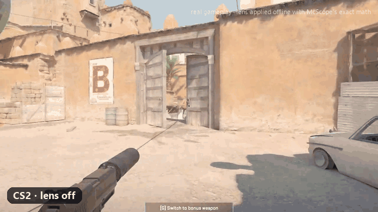
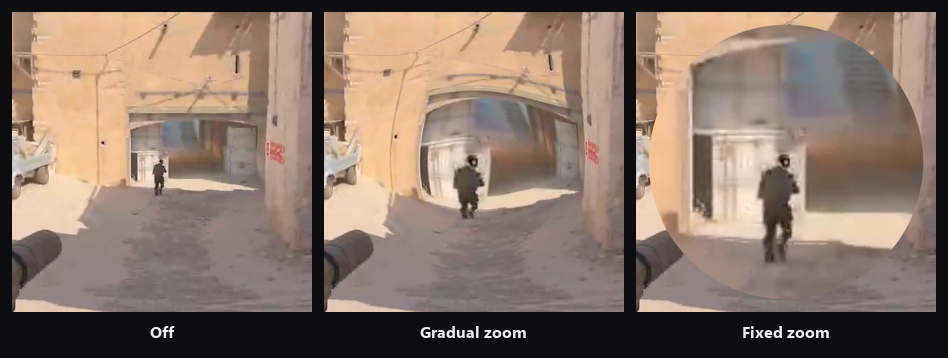
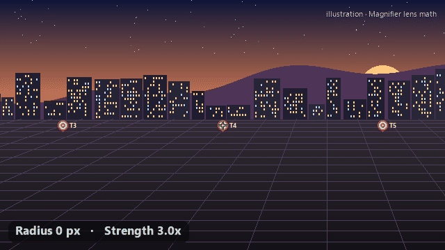
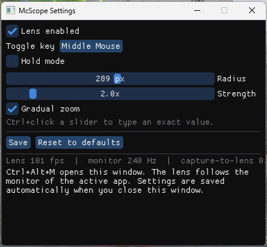
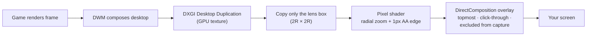

<div align="center">

# McScope

*Scopey McScopeface, for short.*

**A low-latency center-screen zoom lens for fullscreen games on Windows.**
Hold a key or mouse button, and the area under your crosshair is magnified — smoothly, at your monitor's refresh rate, without touching the game.


[](LICENSE)
[](https://github.com/tarekFerdous/McScope/actions/workflows/build.yml)



<sub>Real CS2 gameplay. The lens is applied offline with McScope's exact shader math, because the live lens is hidden from screen capture by design — <a href="#why-cant-i-record-the-lens">here's why</a>.</sub>

</div>

---

## Features

- **Center-screen lens** over borderless, windowed and most "fullscreen" games (DX11, DX12, Vulkan, OpenGL).
- **Two zoom styles**
  - **Gradual** — full strength under the crosshair, easing smoothly to 1× at the edge. No hard seam, so it blends into the game.
  - **Fixed** — the same zoom across the whole circle, like a scope.
- **Live settings** — radius and strength sliders update the lens as you drag.
- **Bind anything** — keyboard keys (with Ctrl/Alt/Shift/Win) or **right, middle and side mouse buttons**.
- **Hold mode** — the lens shows only while the key or button is held. Hold right-click to aim *and* zoom.
- **Instant** — the lens appears within one frame of pressing your bind.
- **Fast** — the whole pipeline stays on the GPU and updates every refresh (144 Hz → 144 fps). Its GPU work runs at raised priority, so a GPU-heavy game doesn't starve the lens.
- **HDR-aware**, **per-monitor DPI-aware**, and follows the monitor your game is on.
- **Never touches the game** — no DLL injection, no hooks, no memory access. [Details below](#is-it-safe-with-anti-cheat).
- Tiny tray app with a single settings window. Settings are saved as JSON.

## How it looks

<p align="center">
  
</p>

<p align="center">
  <br>
  <sub>Radius grows from 0 → 150 px, then strength goes 3× → 6× → 3×. The real sliders update the lens live just like this.</sub>
</p>

## Download

1. Grab the latest `McScope-…-win-x64.zip` from **[Releases](https://github.com/tarekFerdous/McScope/releases)** and extract it anywhere. There's no installer.
2. Run `McScope.exe`. Requires Windows 10 version 2004 or newer, or Windows 11.

**Code signing:** Windows releases will be signed with free code signing provided by [SignPath.io](https://about.signpath.io), certificate by [SignPath Foundation](https://signpath.org). See the [code signing policy](CODE_SIGNING.md).

> **"Windows protected your PC"?** Early releases aren't code-signed yet (the SignPath Foundation application is pending). Click **More info → Run anyway**.
>
> Every release is built from this repo's source by GitHub Actions. Verify yours with:
> ```powershell
> gh attestation verify McScope-<version>-win-x64.zip -R tarekFerdous/McScope
> ```

## Build from source

**Requirements**
- Windows 10 version 2004 (build 19041) or newer, or Windows 11
- Visual Studio 2019 (16.11) or 2022 with the **Desktop development with C++** workload
  (Build Tools are enough; CMake and Ninja ship with it)
- Internet access on the first build (fetches Dear ImGui and nlohmann/json)

**Build**

```powershell
git clone https://github.com/tarekFerdous/McScope.git
cd McScope
.\build.bat              # configure + build + run tests (Release)
```

**Run**

```powershell
.\build\x64-release\McScope.exe
```

The settings window opens on first launch; after that McScope lives in the system tray.

## Usage

| Action | Default |
|---|---|
| Toggle the lens on/off | <kbd>Ctrl</kbd>+<kbd>Alt</kbd>+<kbd>Z</kbd> (rebindable) |
| Open settings | <kbd>Ctrl</kbd>+<kbd>Alt</kbd>+<kbd>M</kbd>, or left-click the tray icon |
| Menu (settings / toggle / exit) | Right-click the tray icon |

### Settings

<p align="center">
  
</p>

| Setting | What it does | Range / default |
|---|---|---|
| **Lens enabled** | Master on/off (same as the toggle key). | on |
| **Toggle key** | Click it, then press any key combo or mouse button (right / middle / Mouse 4 / Mouse 5). <kbd>Esc</kbd> cancels. | <kbd>Ctrl</kbd>+<kbd>Alt</kbd>+<kbd>Z</kbd> |
| **Hold mode** | On: the lens shows only while the binding is held. Off: each press toggles. | off |
| **Radius** | Size of the magnified circle around the screen center. `0` turns it off. | 0 – half the screen height · 200 px |
| **Strength** | Zoom at the exact center. | 1.0× – 10.0× · 2.0× |
| **Gradual zoom** | On: zoom fades from Strength at the center to 1× at the edge. Off: fixed zoom across the whole lens. | on |

<kbd>Ctrl</kbd>+click a slider to type an exact value. The bottom of the window shows live stats: **lens fps**, **monitor Hz** and the **delay**.

> **Picking a bind for games**
> - **Mouse buttons are never blocked.** Right-click still aims in-game while it also drives the lens.
> - **A plain keyboard key in toggle mode is reserved system-wide**, so the game stops receiving it. Use an F-key, a combo like <kbd>Ctrl</kbd>+<kbd>Alt</kbd>+<kbd>Z</kbd>, or hold mode (which doesn't block keys).

## How it works



1. **Capture.** DXGI Desktop Duplication hands over each composed desktop frame as a GPU texture. Nothing is read back to the CPU.
2. **Copy.** Only the small square under the lens is copied, not the whole 4K frame.
3. **Magnify.** A pixel shader remaps each pixel in the circle with the zoom formula below.
4. **Present.** The result goes to a small, transparent, click-through window over the screen center, through DirectComposition with per-pixel alpha. The window is marked `WDA_EXCLUDEFROMCAPTURE`, so the capture never sees the lens and can't zoom into itself.
5. **Pace for latency.** The loop waits for Windows to accept the previous lens frame, *then* grabs the newest desktop frame, draws it, and presents without vsync. That keeps the lens image as fresh as possible.

### The zoom formula

For a pixel at distance `r` from the center, with radius `R` and strength `S`:

```
t = 1 − r / R                       (1 at the center, 0 at the edge)
gradual:  zoom = 1 + (S − 1) · t²
fixed:    zoom = S
sample the screen at  center + (pixel − center) / zoom
```

<p align="center">
  
</p>

Gradual uses `t²` rather than a smoothstep on purpose:
- **No plateau or ring.** Smoothstep stays flat near the center and then squeezes the image into a visible ring near the edge. `t²` starts easing right away and reaches the edge with zero slope.
- **Seamless edge.** Because the slope is zero at the edge, the lens blends into the game with no seam.
- **No fold-over.** The mapping is strictly monotonic, so the image never overlaps itself.

The unit tests lock in all of these properties.

## Performance & latency

| | |
|---|---|
| **Frame rate** | One lens frame per desktop update, up to your **monitor's refresh rate** (60 / 144 / 240 Hz…). That's the most a monitor can show. On a static desktop it idles. |
| **Added delay** | About **one refresh** behind the game's own pixels (≈7 ms at 144 Hz, ≈4 ms at 240 Hz). The lens can only copy a frame after Windows has composed it. |
| **Processing** | Typically well under 1 ms from capture to present. Check the live stat in Settings. |
| **Cost** | A tiny shader on a ≤ 2R × 2R region. GPU work runs at raised priority, and the render thread isn't throttled in the background. |

**Lowest-latency tips:**
- Enable **NVIDIA Reflex** or **AMD Anti-Lag** in the game.
- Or cap the game's fps a little below your refresh rate. When the GPU sits at 100%, the lens waits behind the game's queued frames.

## Is it safe with anti-cheat?

McScope is designed to stay completely outside the game:

- **No DLL injection, no swap-chain or `Present` hooks, no reading or writing game memory.**
- **No keyboard or mouse hooks.** Mouse and hold-mode binds use the standard Raw Input API, which observes input without intercepting it.
- **Capture is a normal Windows API.** It's the same Desktop Duplication used by screen recorders and streaming software.

That said, **no third-party tool can guarantee you won't be flagged**, and a zoom aid may be against the rules of some competitive games or leagues. **Check the game's rules and use it at your own risk.**

## Troubleshooting

<details>
<summary><b>The lens doesn't show over my game</b></summary>

The game is probably in **true exclusive fullscreen**, which bypasses the Windows compositor, so no overlay can draw on top of it. Switch the game to **borderless / windowed fullscreen**. Most modern games running "fullscreen" on Windows 10/11 already work.
</details>

<details>
<summary><b>The lens is black</b></summary>

The game or its anti-cheat blocks screen capture of its window, or the content is DRM-protected (some video players). McScope can't magnify what Windows won't let it capture.
</details>

<details>
<summary><b>My toggle key says "in use by another app"</b></summary>

Another program, or Windows itself, already registered that combination. Pick a different one. Mouse buttons and hold-mode binds never conflict.
</details>

<details>
<summary><b>The build fails with <code>LNK1104: cannot open file 'McScope.exe'</code></b></summary>

McScope is still running, and Windows locks a running exe. Exit it from the tray (right-click → **Exit**) and build again.
</details>

<details>
<summary><b>Where are the settings and logs?</b></summary>

`%APPDATA%\McScope\settings.json` and `%APPDATA%\McScope\log.txt`. A corrupt settings file is renamed to `settings.json.bad` and defaults are used.

```json
{
  "enabled": true,
  "radius": 200,
  "strength": 2.0,
  "gradual": true,
  "toggleKey": { "mods": 3, "vk": 90 },
  "holdMode": false
}
```

`mods` is a bit mask (1 Alt, 2 Ctrl, 4 Shift, 8 Win). `vk` is a Windows virtual-key code (`90` = Z, `2` = right mouse).
</details>

### Why can't I record the lens?

The overlay is marked **excluded from capture** (`WDA_EXCLUDEFROMCAPTURE`). Without that, Desktop Duplication would capture the lens itself and magnify it again, frame after frame, in an endless feedback loop. The side effect is that OBS, ScreenToGif, Xbox Game Bar and screenshots don't see the lens either.

The demos above were made by recording the game with the lens **off** and applying the lens's exact math offline with [`tools/make_demo.py`](tools/make_demo.py):

```powershell
python tools/make_demo.py                 # synthetic illustration
python tools/make_demo.py my_clip.gif     # your own footage (GIF or folder of frames)
```

## Project layout

```
src/
  main.cpp                 tray icon, hotkeys, message loop, single instance
  app/                     settings (JSON), shared state, lens math (CPU mirror), logging, stats
  capture/DesktopDup.*     DXGI Desktop Duplication → GPU texture (lens box only)
  render/LensShader.h      HLSL lens shader
  render/Overlay.*         click-through, capture-excluded DirectComposition window
  render/LensRenderer.*    render thread: low-latency capture → draw → present loop
  input/BindingWatcher.*   raw-input mouse & hold-mode bindings
  ui/                      Dear ImGui settings window, key-name formatting
tests/test_main.cpp        lens math, settings validation, JSON round-trips
tools/make_demo.py         renders the README media
CLAUDE.md                  design decisions & rules for contributors (human or AI)
```

## Development

```powershell
.\build.bat x64-debug        # debug build + tests
ctest --preset x64-release   # tests only (from a VS developer prompt)
```

- [`CLAUDE.md`](CLAUDE.md) records the design decisions and why they were made: capture rules, the low-latency loop order, the zoom formula, input handling.
- If you change the lens formula, update **both** `src/render/LensShader.h` and `src/app/LensMath.h`, then regenerate the docs media.

## Known limitations

- Windows only (Desktop Duplication + DirectComposition).
- The lens can't update faster than the monitor refresh rate, and it runs about one refresh behind the game (see [Performance](#performance--latency)).
- True exclusive-fullscreen games (mostly older DX9 titles) need borderless mode.
- Left mouse button can't be bound, since it would toggle on every click.
- Rotated (portrait) monitors aren't handled yet.

## License

[MIT](LICENSE) © 2026 tarekFerdous: free to use, modify and share, including commercially, as long as the copyright notice is kept. Release signing is covered by the [code signing policy](CODE_SIGNING.md).

Third-party libraries, fetched at build time: [Dear ImGui](https://github.com/ocornut/imgui) (MIT) and [nlohmann/json](https://github.com/nlohmann/json) (MIT).
